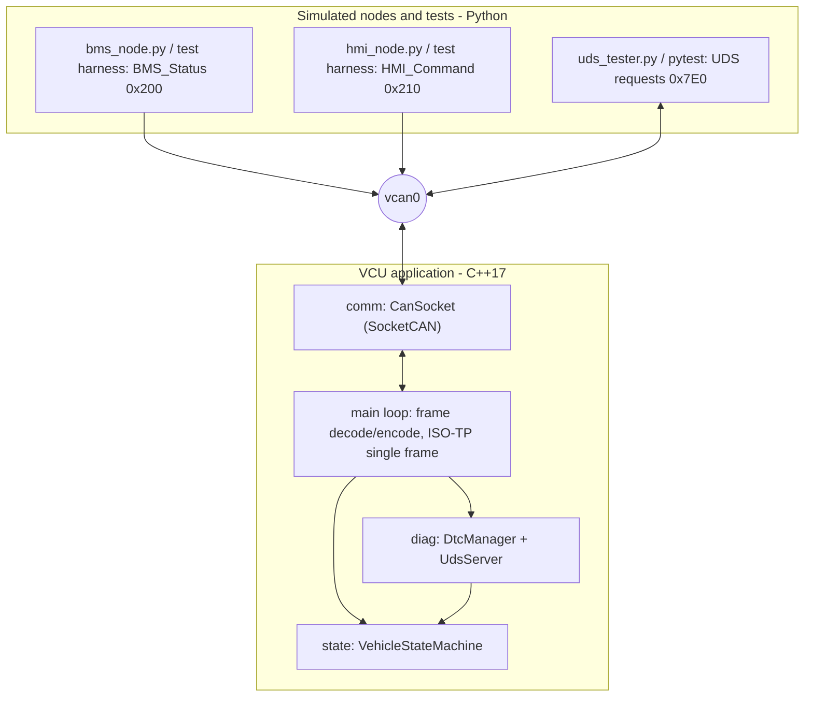
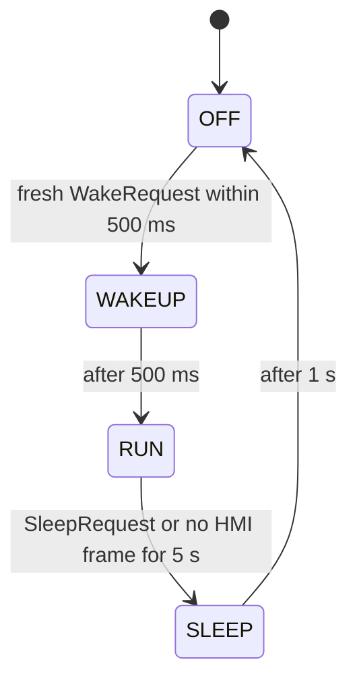

# vcu-platform-sim

A simulated **vehicle control unit (VCU) software platform** running on Linux over a virtual CAN bus (SocketCAN, `vcan0`). It follows a small but complete embedded cycle: requirements, CAN interface definition (DBC), layered C++ architecture, vehicle state management with wake-up/sleep, fault management with DTCs, a minimal UDS diagnostic server, and automated tests.

This is a learning and prototyping project built around micromobility-style signals (battery, driver interface). It is a **simulation**: no real ECU hardware is involved yet (see [Limitations](#limitations)).

## Architecture



- `VehicleStateMachine` and `DtcManager` perform no I/O and take the current time as a parameter, so the logic is testable without a bus.
- Signal layout is defined once in `dbc/vehicle.dbc`. The C++ decoding follows that file; the Python tools and tests use it through `cantools`.

### Vehicle state machine



In RUN, a missing `BMS_Status` for 500 ms raises a fault: `TorqueLimit` goes to 0 and DTC `C11187` (U0111-87, lost communication with the battery unit) is recorded.

## CAN messages

| Message | ID | Sender | Content |
|---------|----|--------|---------|
| `VCU_Status` | 0x100 | VCU | state, fault flag, alive counter, torque limit |
| `BMS_Status` | 0x200 | BMS (simulated) | pack voltage, pack current, state of charge, alive counter |
| `HMI_Command` | 0x210 | HMI (simulated) | wake/sleep requests, throttle, alive counter |
| UDS request / response | 0x7E0 / 0x7E8 | tester / VCU | ISO-TP single frames |

## UDS services implemented

| Service | Support |
|---------|---------|
| 0x10 DiagnosticSessionControl | default (0x01) and extended (0x03) sessions, S3 timer 5 s |
| 0x3E TesterPresent | sub-function 0x00, and 0x80 (suppress response) |
| 0x22 ReadDataByIdentifier | one DID per request: `F186` active session, `F195` software version, `0100` pack voltage, `0101` state of charge, `0102` vehicle state |
| 0x19 ReadDTCInformation | sub-function 0x01 (count by status mask), 0x02 (list by status mask) |
| 0x14 ClearDiagnosticInformation | all DTCs (`FF FF FF`), extended session only |

This is a minimal subset. Negative responses implemented: 0x11, 0x12, 0x13, 0x14, 0x31, 0x7F.

## Getting started

Requirements: Linux with the `vcan` kernel module, `can-utils`, CMake, a C++17 compiler, Python 3.10+.

```bash
sudo apt install -y build-essential cmake can-utils python3-venv
python3 -m venv .venv && source .venv/bin/activate
pip install -r requirements.txt

bash scripts/setup_vcan.sh
cmake -S . -B build && cmake --build build
```

Run the simulation (one terminal each):

```bash
./build/vcu                                   # VCU
python tools/bms_node.py                      # simulated battery, start before the HMI
python tools/hmi_node.py --run-seconds 10     # simulated driver interface
candump vcan0,100:7FF | cantools decode dbc/vehicle.dbc   # decoded VCU_Status
```

Expected VCU output:

```
OFF -> WAKEUP
WAKEUP -> RUN
RUN -> SLEEP
SLEEP -> OFF
```

Query the diagnostic server:

```bash
python tools/uds_tester.py 10 03          # extended session
python tools/uds_tester.py 22 01 00       # pack voltage
python tools/uds_tester.py 19 02 FF       # stored DTCs
python tools/uds_tester.py 14 FF FF FF    # clear DTCs
```

## Tests

Stop any manually started VCU or node first (the test bench refuses to run if `vcan0` already carries traffic), then:

```bash
pytest -v
```

The suite starts a fresh `vcu` process for each test, simulates the BMS and HMI, and checks the behavior against `REQUIREMENTS.md`:

| Requirement | Test |
|-------------|------|
| REQ-001 wake-up | `test_req001_wake_on_hmi_request` |
| REQ-002 HMI timeout to sleep | `test_req002_hmi_timeout_goes_to_sleep` |
| REQ-003 BMS timeout, fault, DTC | `test_req003_bms_timeout_sets_fault_and_dtc` |
| REQ-004 data and DTC reading | `test_req004_read_data_and_dtc_services` |
| REQ-005 UDS transport, error codes | `test_req005_uds_transport_and_error_codes` |
| REQ-006 clear DTC needs extended session | `test_req006_clear_dtc_requires_extended_session` |
| REQ-007 S3 timeout | `test_req007_s3_timeout_returns_to_default_session` |

## Limitations

- **Simulation only.** Nodes are Python scripts on a virtual bus. Timing is measured on a non-real-time Linux VM.
- **Classic CAN only.** CAN FD and LIN are not implemented.
- **ISO-TP single frames only.** No segmentation or flow control, so responses are limited to 7 bytes.
- **UDS is a minimal subset.** No security access (0x27), no write services, one DID per request.
- **DTCs live in RAM** and are lost when the process restarts. There is one DTC, and the status byte is a subset of ISO 14229.
- **Not AUTOSAR and not safety-certified.** The layered structure (communication, state management, diagnostics) is inspired by common ECU software architectures, nothing more.

## Roadmap

- Port a node to an ESP32 (TWAI controller with a CAN transceiver) on a real bus
- CAN FD frames and ISO-TP multi-frame transfers
- Simulated LIN master and slaves
- Non-volatile DTC storage

## Repository layout

```
dbc/            CAN database (vehicle.dbc)
src/comm/       SocketCAN wrapper
src/state/      vehicle state machine
src/diag/       DTC manager, UDS server
src/main.cpp    application loop, frame encode/decode
tools/          simulated nodes and UDS tester (Python)
tests/          pytest test bench and requirement tests
scripts/        vcan setup
```